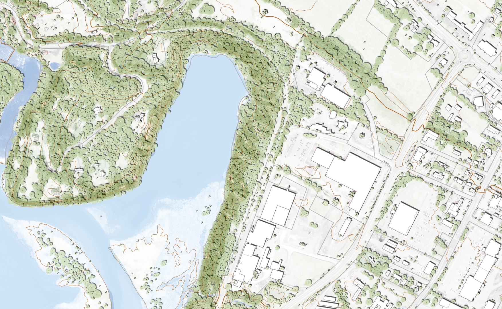
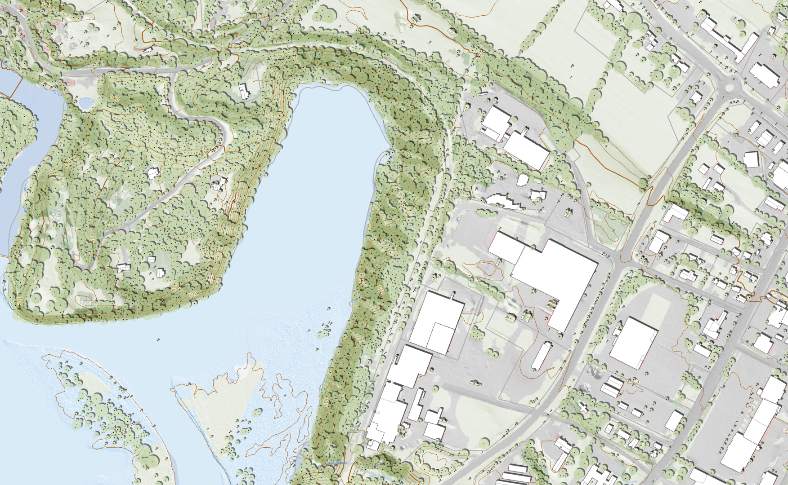

# Reference Basemaps

External basemap styles kept here as design and technical references, not
as styles this repo depends on or redistributes. They're useful for two
different reasons:

- **Design reference** — established, widely-used visual treatments
  (muted/canvas-style light, dark, general-purpose "bright", 3D) worth
  comparing our own Light/Dark/Physical Geography/monochrome work against.
- **Technical reference** — most entries below are [MapLibre/Mapbox GL
  style.json](https://maplibre.org/maplibre-style-spec/) documents, several
  built against the [OpenMapTiles](https://github.com/openmaptiles/openmaptiles)
  vector tile schema, a mature, widely-adopted schema for exactly the kind
  of vector basemap tiles this project is moving toward with PMTiles (see
  [`../architecture/foundational-layers.md`](../architecture/foundational-layers.md)).
  Worth consulting for source-layer naming and layer-ordering conventions
  when designing our own PMTiles vector schema.

Entries are grouped by source below, since not everything here will come
from OpenMapTiles — add a new `## <Source>` section for anything from
elsewhere rather than assuming everything shares a license or schema.

## Source: OpenMapTiles

Maintained under the [openmaptiles GitHub org](https://github.com/openmaptiles);
source for the vector tile schema itself lives in
[openmaptiles/openmaptiles](https://github.com/openmaptiles/openmaptiles).

| Style | Repo | Vermont demo | Description | License |
|---|---|---|---|---|
| MapTiler Basic | [maptiler-basic-gl-style](https://github.com/openmaptiles/maptiler-basic-gl-style) | [demo](https://openmaptiles.github.io/maptiler-basic-gl-style/#7.57/43.96/-72.485) | Tries to stay in the background and only give the most relevant information. | BSD-3-Clause (style code); derived from Mapbox Open Styles |
| OSM Bright | [osm-bright-gl-style](https://github.com/openmaptiles/osm-bright-gl-style) | [demo](https://openmaptiles.github.io/osm-bright-gl-style/#7.95/43.899/-72.682) | General-purpose basemap showcasing the detail of OpenStreetMap data; a good starting point for more complex basemaps. | BSD-3-Clause (style code); derived from Mapbox Open Styles |
| Positron | [positron-gl-style](https://github.com/openmaptiles/positron-gl-style) | [demo](https://openmaptiles.github.io/positron-gl-style/#7.85/43.863/-72.595) | Light basemap, ideal as a non-obtrusive base for data visualizations. | BSD-3-Clause (style code); **cartography by Stamen Design/Paul Norman, via CartoDB Basemaps, CC-BY 3.0** — attribution required if we reuse/derive from this design |
| Dark Matter | [dark-matter-gl-style](https://github.com/openmaptiles/dark-matter-gl-style) | [demo](https://openmaptiles.github.io/dark-matter-gl-style/#7.85/43.9/-72.506) | Dark basemap, a good starting point for other darker designs. | BSD-3-Clause (style code); **cartography by Stamen Design/Paul Norman, via CartoDB Basemaps, CC-BY 3.0** — attribution required if we reuse/derive from this design |
| Fiord Color | [fiord-color-gl-style](https://github.com/openmaptiles/fiord-color-gl-style) | [demo](https://openmaptiles.github.io/fiord-color-gl-style/#7.88/43.88/-72.539) | Cool blue-toned basemap optimized for data visualizations; muted palette keeps overlay data layers in focus. | BSD-3-Clause (style code); **same CartoDB/Stamen lineage as Positron/Dark Matter, CC-BY 3.0** — attribution required if we reuse/derive from this design |
| MapTiler 3D | [maptiler-3d-gl-style](https://github.com/openmaptiles/maptiler-3d-gl-style) | [demo](https://openmaptiles.github.io/maptiler-3d-gl-style/#7.95/43.89/-72.5/-24.8/47) | 3D buildings extrusion style; a GL basemap demonstrating 3D building rendering from the OpenMapTiles schema. | BSD-3-Clause (style code); derived from Mapbox Open Styles |

### Notes

- "BSD-3-Clause (style code)" covers the `style.json`/build tooling in each
  repo. It's separate from the cartographic design license — GitHub's own
  license detector reports `NOASSERTION` for all six repos since the
  license terms are nonstandard (split between code and design), so always
  check each repo's `LICENSE.md` directly rather than trusting the
  detected badge.
- Positron, Dark Matter, and Fiord Color all trace back to the same
  Stamen/CartoDB-designed cartography (CC-BY 3.0). If our own Light, Dark,
  or monochrome basemaps end up visually derivative of one of these three
  specifically (as opposed to just "inspired by, redrawn independently"),
  attribution is required, not optional.
- MapTiler Basic, OSM Bright, and MapTiler 3D trace back to Mapbox Open
  Styles instead, with no equivalent CC-BY design requirement noted in
  their license files.

## Source: LINZ (Land Information New Zealand)

Unlike the OpenMapTiles entries above, this one is less about visual
style and more a **distribution-architecture precedent** — LINZ runs a
production open basemap service that's a close analog of what VCGI's
open-source side could eventually look like.

- **Service:** [basemaps.linz.govt.nz](https://basemaps.linz.govt.nz) —
  Topographic example:
  [`@-45.8765697,167.2375897,z12.11?style=topographic-v2&i=topographic-v2&labels=true`](https://basemaps.linz.govt.nz/@-45.8765697,167.2375897,z12.11?style=topographic-v2&i=topographic-v2&labels=true)
- **Documentation:** [LINZ Basemaps Guide](https://www.linz.govt.nz/guidance/data-service/linz-basemaps-guide/linz-basemaps-documentation)
- **Code (self-hostable):** [github.com/linz/basemaps](https://github.com/linz/basemaps) —
  MIT-licensed

### Architecture

- **Two separate products, different formats:** an *Aerial* basemap
  (raster imagery, WMTS/XYZ, WebP/JPEG/PNG) and a *Topographic* basemap
  (vector, MVT/PBF) — not one monolithic service. Worth considering for
  our own Light/Dark/Physical Geography split: are these genuinely
  separate services/endpoints, or one service with style variants?
- **Two tiling schemes:** WGS84 Web Mercator (EPSG:3857, the usual web
  scheme) *and* NZTM2000 Quad (EPSG:2193, their national grid) — the
  topographic/vector product is Web Mercator-only, but aerial imagery
  supports both. A reminder that "serve in the web-standard scheme" and
  "serve in the state's own authoritative scheme" aren't mutually
  exclusive.
- **TileJSON + StyleJSON as the client contract** — same pattern already
  used in this repo's PMTiles work, not a new idea to adopt, more a
  confirmation it's the right one.
- **API key tiers:** a no-registration **standard** tier (dynamic key,
  rate-limited — 1,000 requests/minute, 1M/month, expires every 90 days,
  regenerated by revisiting the basemaps app) vs. a **developer** tier
  (request directly from LINZ, effectively unmetered, static
  non-expiring key, can be domain-restricted). Directly relevant if VCGI
  ever needs to rate-limit or meter the open PMTiles/TiTiler endpoints —
  right now those are fully open, no key at all.
- **Hosted service vs. self-hosted code are intentionally decoupled:**
  `basemaps.linz.govt.nz` is LINZ's own managed, rate-limited instance;
  the GitHub repo is the same codebase published for others to run
  themselves if they have "business critical or high-volume" needs. The
  two aren't required to stay in sync.
- **Licensing is split in two layers, cleanly separated:** the *code* is
  MIT-licensed; the *underlying map data* is CC-BY 4.0 with a required
  attribution link to a dedicated per-source attribution page. Worth
  deciding our own equivalent split explicitly (VCGI's data vs. the
  pipeline/tooling code) rather than leaving it implicit.

(Not legal advice — read LINZ's own Terms of Use and licensing pages
directly before treating any of the above as settled for our purposes.)

## Source: UGRC (Utah Geospatial Resource Center)

Another state-run basemap program, published as a trio of named
general-purpose basemaps rather than one product:

- [Hybrid](https://gis.utah.gov/products/sgid/base-maps/hybrid/) —
  reference cartography blended with current high-resolution aerial
  imagery; most features (lakes, rivers, land ownership, parks) are shown
  as labels only, not drawn polygons, so the imagery stays the visual
  focus.
- [Lite](https://gis.utah.gov/products/sgid/base-maps/lite/) — "a light,
  muted, general reference base map that doesn't compete with your
  thematic data." Roads/highways/rail plus county and municipal
  boundaries, with building footprints and address-point house numbers
  appearing only at closer zoom.
- [Terrain](https://gis.utah.gov/products/sgid/base-maps/terrain/) — land
  cover + DEM-derived relief, built around a "unique 2 layer hillshade and
  50 foot contours," plus agricultural land, wetlands, a 2016 Great Salt
  Lake level layer, highways, rail, and boundary layers.
- [Connecting to Discover (client docs)](https://gis.utah.gov/documentation/discover/clients/) —
  how to consume any of the three from QGIS, ArcGIS Pro/Online, CAD
  software, and custom web apps.

### Architecture

- **All three are raster, not vector tiles** — pre-rendered 256px tiles,
  Web Mercator (EPSG:3857), at Esri's standard common zoom scales. Unlike
  LINZ's Topographic product above, there's no vector/MVT counterpart to
  any of these three.
- **No API keys — access is via unique per-user links instead.** Their
  "Discover" delivery platform authenticates through an unguessable
  per-user URL segment (a "quad-word," e.g.
  `bottle-apple-crater-oberon`), not a login or key. Client docs
  explicitly say to leave any client's auth fields blank.
- **Public web maps using their licensed high-res imagery need separate
  "locked-down" links** — the default per-user links aren't meant to be
  embedded in something publicly shared; a distinct link type exists for
  that case. Worth noting as a contrast to VCGI's own TiTiler/PMTiles
  endpoints, which are fully open with no per-user link step at all.
- **Custom web app access is documented specifically for the ArcGIS Maps
  SDK for JavaScript**, via `WebTileLayer` pointed at a Discover tile URL
  template (`.../tiles/lite_basemap/{level}/{col}/{row}`). Directly
  relevant if VCGI's basemaps end up needing a non-Map-Viewer ArcGIS
  consumption path: confirms `WebTileLayer` (not just a Vector Tile Layer
  item) is a workable route for raster basemap tiles in that SDK.
- **Cache-level mismatch caveat:** `WebTileLayer`'s default assumed zoom
  levels (0–19, the common set shared by most commercial tile providers)
  don't always match Discover's actual basemap zoom levels, requiring a
  manually-constructed `TileInfo`/`LOD` object (tile size, origin,
  spatial reference, per-level resolution) rather than relying on the
  class's defaults — a concrete example of a style/service needing to
  describe its own zoom scheme explicitly rather than assuming a client
  library's default matches.
- **UGRC publishes their own `layer-selector` npm package** to handle
  basemap-switching/overlay-toggling and paper over the cache-level
  configuration work above — an example of a small reusable client-side
  helper rather than solving it per-app.
- No licensing/attribution terms are stated on the basemap product pages
  themselves (unlike LINZ's explicit CC-BY 4.0 data license above) — not
  confirmed as "no license" so much as "not stated where we looked."

(Not legal advice — contact UGRC (`ugrc@utah.gov`) or read their own
policies directly before treating any of the above as settled for our
purposes.)

## Source: VCGI (internal, 2024 development tests)

Screenshots (not style files) from earlier, unpublished VCGI basemap
exploration in
[VCGI/standards-and-guidelines-dev](https://github.com/VCGI/standards-and-guidelines-dev/tree/main/basemaps)
(private repo — the images below are mirrored here since that repo isn't
broadly accessible). Internal design reference, not an external style to
compare against like the OpenMapTiles entries above.

### Large Scale Physical Geography — Site Planning

Likely not a "basemap" in the sense of the other entries here — more a
potential toggle-able set of layer states and styling in a web
application, useful for as-built site planning and conceptual
development at large scale. Shows contours, individual tree-canopy point
symbols, building footprints, and impervious/paved surfaces together at
a scale where those details are legible (source repo credits this to a
"2024 KEHS COG and Basemap Test" ArcGIS Pro project).

